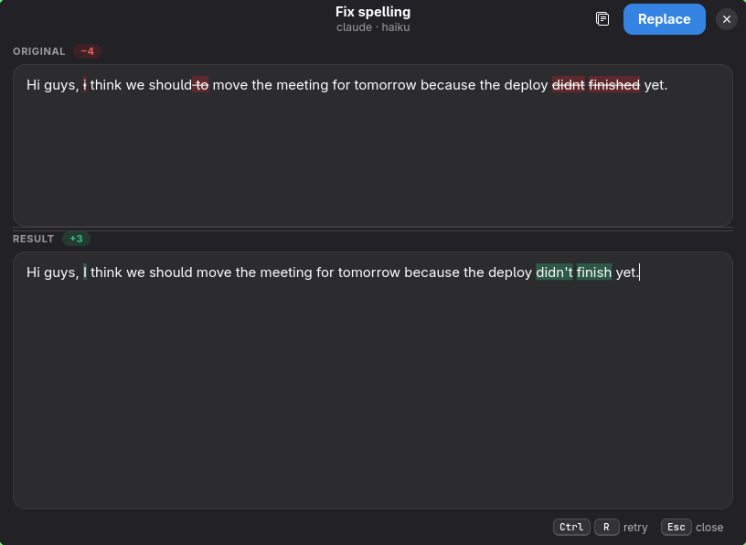
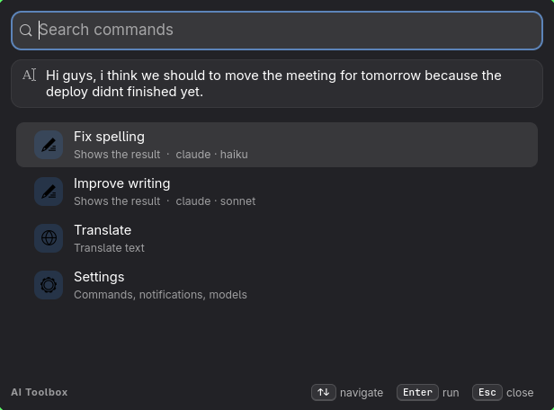
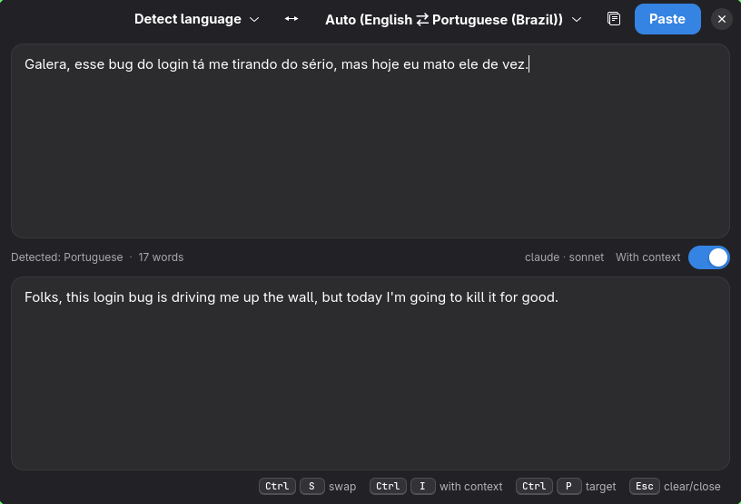
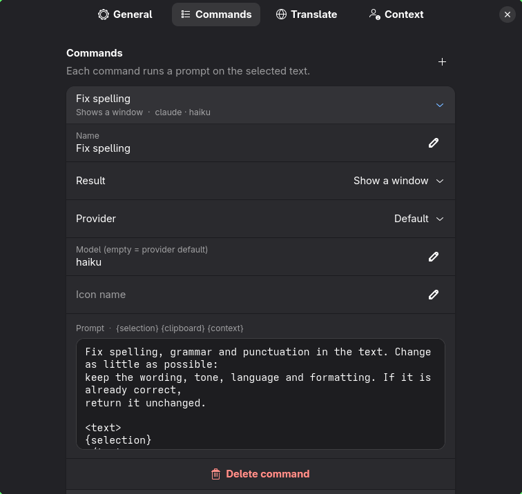
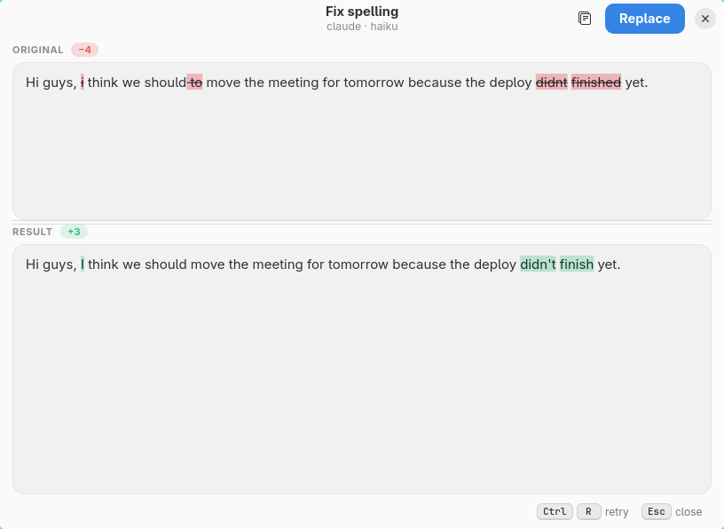

<p align="center">
  
</p>

<h1 align="center">AI Toolbox</h1>

<p align="center">Raycast-style AI text commands and translator for Wayland desktops.<br>
Select text anywhere, press a shortcut, get it fixed, rewritten or translated.</p>

<p align="center">
  
</p>

- **Commands.** Fix spelling, improve writing, change tone: each one is a small
  TOML file with a prompt. `output = "replace"` swaps the selection in place,
  no window; `output = "window"` shows the result first, streaming, with the
  changed words highlighted. Ctrl+Enter puts it back over the selection.
- **Ask for changes.** A field under the result takes free instructions
  ("more formal", "as bullet points") and reworks the current result; Ctrl+R
  reruns the command on it, including your edits.
- **Dictation.** Press a shortcut, talk, press it again: local Whisper
  (large-v3-turbo on an NVIDIA GPU, ~0.4 s for a sentence; a small model on
  the CPU otherwise) types the text where you were. `--then fix-spelling`
  (or any command) cleans it up first. Nothing leaves your machine.
- **Personal dictionary.** Product names and jargon that no command or
  translation ever changes.
- **Command palette.** One shortcut lists every command; type to filter, Enter to run.
- **Translator.** Source on top, translation below, live as you type, language
  detected on the fly. Literal by default; **With context** (Ctrl+I) adapts the
  translation to who you are and who you write to (`context.md`), and tells you
  when it changed something on purpose.
- **Your own AI accounts.** Uses the Claude and ChatGPT subscriptions you
  already have through their official CLIs (no API keys), or local models
  through any OpenAI-compatible endpoint (Ollama, LM Studio, llama.cpp).
- **Fits your desktop.** GTK 4 + libadwaita: follows your light/dark mode,
  accent and theme colors. UI in your system language (English, Portuguese).

## Screenshots

| Command palette | Translator, with context |
|---|---|
|  |  |
| **Settings** | **Light theme** |
|  |  |

The windows use libadwaita colors, so they follow light/dark mode, the accent
color and custom GTK color schemes (e.g. matugen/wallust themes).

## Requirements

- A Wayland session, `wl-clipboard`, `libnotify`
- GTK 4, libadwaita and PyGObject from your distro (Python ≥ 3.11)
- At least one model provider:
  - [`claude`](https://docs.claude.com/en/docs/claude-code) logged in with a Claude subscription
  - [`codex`](https://github.com/openai/codex) logged in with a ChatGPT subscription
  - [Ollama](https://ollama.com) or another OpenAI-compatible server

### Desktop support

| Desktop | Window tracking | Paste back |
|---|---|---|
| Hyprland | native IPC | native (no extra tools) |
| Sway, niri | native IPC | `wtype` or `ydotool` |
| KDE, GNOME | — | RemoteDesktop portal (asks once, then remembered), or `ydotool` |
| Others | — | `ydotool` |

Without a window-tracking IPC, focus simply returns to the app when the
window closes. Without a way to send keys the result stays on the clipboard
and a notification tells you to press Ctrl+V.

> The portal path is tested against a fake portal on a private D-Bus
> (`tests/test_portal.py`), not yet on a real GNOME/KDE session. Reports welcome.

Text comes from the primary selection: just highlight it. For apps without
one, `copy_fallback = true` sends them a Ctrl+C instead (never to terminals).

Dictation also needs [uv](https://docs.astral.sh/uv) and PipeWire (`pw-record`):
the first use creates `~/.local/share/ai-toolbox/stt-venv` with faster-whisper
(plus the CUDA libraries on NVIDIA, ~1 GB in total) and downloads the model.

## Install

Arch (AUR-style package in [`packaging/arch`](packaging/arch/PKGBUILD)):

```sh
cd packaging/arch && makepkg -si
```

From a checkout:

```sh
ln -s "$PWD/bin/ai-toolbox" ~/.local/bin/ai-toolbox
```

The first run copies the example config to `~/.config/ai-toolbox/`.

For instant windows, keep it running (the package ships the unit):

```sh
systemctl --user enable --now ai-toolbox.service   # runs `ai-toolbox daemon`
```

Without it everything still works; each call just starts its own process.
After updating a checkout, `systemctl --user restart ai-toolbox`.

### Shortcuts

Bind these in your compositor:

| Shortcut (suggested) | Command |
|---|---|
| Super+Alt+C | `ai-toolbox run fix-spelling` |
| Super+Alt+T | `ai-toolbox translate` |
| Super+Alt+Space | `ai-toolbox` (palette) |
| Super+Alt+D | `ai-toolbox dictate` (again to stop) |
| Super+Alt+Shift+D | `ai-toolbox dictate --then fix-spelling` |

Hyprland (Lua config):

```lua
hl.window_rule({ match = { class = "dev.aitoolbox.AiToolbox" }, float = true, center = true })
-- the dictation pill: bottom center, on every workspace
hl.window_rule({ match = { class = "dev.aitoolbox.AiToolbox", title = "^AI Toolbox · Dictation$" },
                 float = true, pin = true, move = { "((monitor_w-window_w)/2)", "(monitor_h-window_h-80)" } })
```

Sway: `for_window [app_id="dev.aitoolbox.AiToolbox"] floating enable`.
niri: a `window-rule` matching `app-id="dev.aitoolbox.AiToolbox"` with `open-floating true`.

## Usage

```
ai-toolbox                    command palette
ai-toolbox run <command>      run on the selection (output from the command file)
ai-toolbox window <command>   same, always showing the result window
ai-toolbox translate          translator, prefilled with the selection
                              (--empty: start empty, --context: with context on)
ai-toolbox dictate            start/stop dictation (--then <command>, --cancel)
ai-toolbox settings           settings window
ai-toolbox list               list commands
ai-toolbox daemon             stay running so windows open instantly
```

| Window | Keys |
|---|---|
| Result | Ctrl+Enter replace · Ctrl+Shift+C copy · Ctrl+L ask for a change · Ctrl+R retry · Esc close |
| Translator | Ctrl+Enter paste into app · Ctrl+Shift+C copy · Ctrl+S swap · Ctrl+I with context · Ctrl+P / Ctrl+Shift+P target / source · Esc clear, then close |

## Configuration

`ai-toolbox settings` (also in the palette) edits everything and saves as you go:

- **General**: notifications (all, errors only, off), copy fallback, default
  provider, models, local models (Ollama).
- **Commands**: create, edit and delete commands. Per command, choose **Show a
  window** (review and edit, Ctrl+Enter to replace) or **Replace directly**
  (no window, progress in notifications).
- **Translate**: language pair, extra languages, models for literal and
  contextual translation.
- **Context**: `context.md`, who you are and how you write.

The files live in `~/.config/ai-toolbox/` (`config.toml`, `commands/*.toml`,
`context.md`) and are fine to edit by hand; see [`examples`](examples).

### Adding a command

One file per command in `~/.config/ai-toolbox/commands/<id>.toml`:

```toml
name = "Make it friendlier"
icon = "face-smile-symbolic"   # optional, any symbolic icon name
output = "window"              # "replace" or "window"
provider = "claude"            # optional: a provider from config.toml
model = "haiku"                # optional
prompt = """
Rewrite the text in a warmer, friendlier tone. Keep the meaning and language.

<text>
{selection}
</text>
"""
```

Placeholders: `{selection}`, `{clipboard}`, `{context}` (the contents of
`context.md`), `{language}` (the system language, e.g. for "explain in
{language}"). `diff = false` turns off change highlighting for commands whose
answer is not a new version of the text (like Explain). Without `{selection}` the text is appended to the prompt.

## Development

```sh
uv run --no-project --with pytest python -m pytest     # core tests
# GTK/D-Bus tests need PyGObject: run with a venv using --system-site-packages
```

Adding a UI language: add a table to [`ai_toolbox/i18n.py`](ai_toolbox/i18n.py).
Screenshots: `scripts/screenshots.sh` (Hyprland) regenerates `docs/screenshots`.

## License

[MIT](LICENSE)
